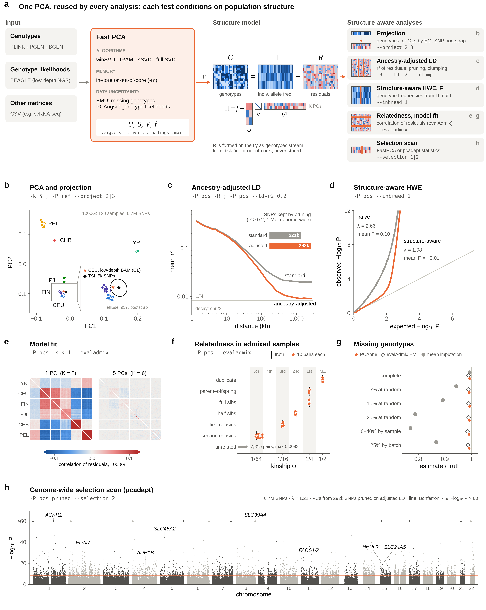

# Principal Component Analysis All in One (v0.9.0)

<a href="https://github.com/Zilong-Li/PCAone/actions/workflows/linux.yml"></a>
<a href="https://github.com/Zilong-Li/PCAone/actions/workflows/mac.yml"></a>
<a href="https://github.com/Zilong-Li/PCAone/releases/latest"></a>
<a href="https://zilongli.org/PCAone/"></a>

PCAone is a scalable and memory-efficient C++ tool for principal component analysis(PCA). 
It runs with all data in memory or streams it from disk, so biobank-scale data fit on an ordinary machine. PCA methods supported (`--svd`): 
window-based randomized SVD (default, ours), single-pass randomized SVD, IRAM, and exact sample-GRM eigendecomposition.

What sets PCAone apart is **structure-aware analysis**. Standard estimators of
relatedness, LD and HWE assume one homogeneous population with a single allele
frequency per site. In structured or admixed samples, that assumption turns
population structure into false signal. PCAone models the structure with the
top PCs of one PCA run with informative SNPs, saved once and read back with `-P/--USV`:

- **Relatedness (`--evaladmix`):** with one allele frequency per site,
  unrelated samples from the same population look related. PCAone estimates
  pairwise kinship from the correlation of the genotype residuals left after
  the PCs (evalAdmix, with PCA in place of an admixture model), so no
  admixture run is needed.
- **LD (`--ld-r2`, `--clump`):** variants that differ in frequency between
  populations are correlated even when far apart, so pruning on standard LD
  removes too many. PCAone computes LD on the residuals after removing the
  PCs, and prunes and clumps on that ancestry-adjusted LD.
- **HWE and inbreeding (`--inbreed`):** pooling populations creates a deficit
  of heterozygotes (the Wahlund effect), so standard tests flag every
  differentiated site. PCAone tests each site against individual allele
  frequencies, the frequency for each sample predicted from the PCs.

It handles the main kinds of genetic data:

- **Array or imputed genotypes:** PLINK BED, PLINK2 PGEN (dosages when
  available) and BGEN.
- **Low-coverage sequencing:** genotype likelihoods in BEAGLE format, with
  PCAngsd-style EM-PCA (`--pcangsd`).
- **Missing data:** EM-PCA (`--emu`) imputes missing genotypes from the PCs
  instead of filling them with the mean.

PCAone also projects new samples onto the PCs of a reference panel without
recomputing them, built for sparse data such as ancient DNA and low-coverage
sequencing:

- **Called genotypes with missing calls (`--project 2`):** each sample is
  fitted on its own called sites only, rather than filling the gaps with the
  reference allele frequency.
- **Low-coverage data (`--project 3`):** projects genotype likelihoods (BEAGLE)
  directly, by EM, without calling genotypes.
- **Bootstrap (`--project-bootstrap`):** resamples the matched SNPs to give
  each projected sample a standard error and PC covariances for uncertainty
  ellipses (with `--project 2`).
- **Biobank-size targets:** `--project 1` and `2` stream the target in blocks,
  within 2 GB or the `-m` given, straight from its 2-bit PLINK/PGEN calls, so
  any number of samples is projected in one run, several times faster than
  plink2 `--score`.

Also included: selection scans, and PCA of other data such as zstd-compressed
CSV counts.

[Documentation](https://zilongli.org/PCAone/) · [Change log and migration notes](docs/changelog.md) · [R package](https://github.com/Zilong-Li/PCAoneR)



*One PCA, reused by structure-aware analyses. (a) PCAone saves U, S, V and the allele frequencies f; every downstream analysis reads them back with `-P/--USV`. (b–h) Examples on 1000 Genomes samples and on admixed samples with known relatedness.*

## Installation

Install with [Bioconda](https://anaconda.org/bioconda/pcaone):

```shell
conda install -c conda-forge -c bioconda pcaone
PCAone --help
```

Or download a Linux/macOS binary from the [releases page](https://github.com/Zilong-Li/PCAone/releases).

To build from source, use a C++17 compiler, GNU make, and zlib. On macOS,
install OpenMP first with `brew install libomp`.

```shell
git clone https://github.com/Zilong-Li/PCAone.git
cd PCAone
make -j4
./PCAone --help
```

See [Installation](docs/installation.md) for MKL and OpenBLAS builds.

## Quick start

```shell
# PLINK BED/BIM/FAM: compute 10 PCs
PCAone -b data -k 10 -o pcs

# PLINK2 PGEN/PVAR/PSAM: use dosages when available
PCAone -p data -k 10 -o pcs

# Out-of-core PCA with a 2 GB memory setting
PCAone -b data -k 10 -m 2 -o pcs
```

Replace `data` with your input prefix. Add `--hardcall` to use PGEN hard calls.
`-m` sizes the working blocks, so total RAM can exceed it.

| Output      | Contents                                       |
| ----------- | ---------------------------------------------- |
| `.eigvecs`  | PC coordinates: samples × PCs                  |
| `.eigvecs2` | The same with FID/IID columns and a header     |
| `.eigvals`  | Eigenvalues                                    |
| `.sigvals`  | Singular values and scaling metadata           |
| `.loadings` | Feature loadings; skip with `--no-loadings`    |
| `.mbim`     | Variant metadata and frequencies with loadings |
| `.log`      | Run settings and progress                      |

For up to a few thousand samples, use `--svd 3` for exact PCA. It holds an
N × N sample GRM in memory and does not support EM-PCA. Keep the
default `--svd 2` for large datasets; see
[choosing a PCA method](docs/guide/pca.md).

## Common workflows

Most analyses take two steps: compute the PCs once, then pass them back with
`-P/--USV`.

```shell
# Step 1: compute the PCs once
PCAone -b data -k 3 -o pcs

# Relatedness: pairwise kinship from the PCA residuals
PCAone -b data -P pcs --evaladmix -o rel

# LD pruning adjusted for ancestry
PCAone -b data -P pcs --ld-r2 0.2 -o pruned

# HWE tests and inbreeding that account for population structure
PCAone -b data -k 3 --pcangsd -o pcs_hwe
PCAone -b data -P pcs_hwe --inbreed 1 -o hwe

# Build a reference and project new samples, with 100 bootstrap replicates
PCAone -b reference -k 10 -o ref
PCAone -b target -P ref --project 2 --project-bootstrap 100 -o projected

# Project low-coverage samples from genotype likelihoods
PCAone -G target.beagle.gz -P ref --project 3 -o projected_gl

# PCA for count data in zstd-compressed CSV
PCAone -c counts.csv.zst -k 10 --scale 2 -S -o counts
```

Projection requires compatible genome builds and alleles. Relatedness, LD and
HWE require the same samples in the same order as the reference PCA. Analyses
using `-P` use every reference PC unless `-k` selects the leading PCs.

## Documentation

The full documentation is at **[zilongli.org/PCAone](https://zilongli.org/PCAone/)**; its
Markdown sources are in [`docs/`](https://github.com/Zilong-Li/PCAone/tree/main/docs).

- [Install](docs/installation.md): binaries, Bioconda, and builds with MKL or OpenBLAS.
- User guide: [options](docs/guide/options.md), [input and output](docs/guide/input-output.md),
  [choosing a PCA method](docs/guide/pca.md), and [plotting](docs/guide/plotting.md)
  SNP loadings and LD decay.
- [Small-N](docs/small-n/index.md), up to a few thousand samples: [exact PCA and EM-PCA](docs/small-n/pca.md),
  [projection](docs/small-n/projection.md), [selection scans](docs/small-n/selection.md),
  [HWE and inbreeding](docs/small-n/hwe.md), [relatedness](docs/small-n/relatedness.md), and
  [ancestry-adjusted LD](docs/small-n/ld.md).
- [Biobank analysis](docs/biobank/index.md), tens of thousands of samples or more:
  [out-of-core PCA](docs/biobank/pca.md), [projection](docs/biobank/projection.md),
  [LD pruning and clumping](docs/biobank/ld.md), [relatedness](docs/biobank/relatedness.md), and
  [plotting large cohorts](docs/biobank/plotting.md).
- [Change log](docs/changelog.md): release history, result changes, and legacy command migration.

Each analysis guide ends with the method details: the model, how PCAone
computes it, and how it was checked.

Run `PCAone --help` for all options, or generate a man page:

```shell
PCAone --groff > pcaone.1
man ./pcaone.1
```

## Citation

Please cite [Fast and accurate out-of-core PCA framework for large scale biobank data](https://genome.cshlp.org/content/early/2023/10/05/gr.277525.122)
when using PCAone. For specific analyses, also cite:

- EMU: [Large-scale inference of population structure in presence of missingness using PCA](https://academic.oup.com/bioinformatics/article/37/13/1868/6103565).
- PCAngsd: [Inferring Population Structure and Admixture Proportions in Low-Depth NGS Data](https://www.genetics.org/content/210/2/719).
- Ancestry-adjusted LD: [Measuring linkage disequilibrium and improvement of pruning and clumping in structured populations](https://doi.org/10.1093/genetics/iyaf009).

## Contributing and acknowledgements

Issues and contributions are welcome. PCAone uses [Eigen](https://eigen.tuxfamily.org/),
[Spectra](https://github.com/yixuan/spectra), and a BGEN reader adapted from [jeremymcrae/bgen](https://github.com/jeremymcrae/bgen);
its EMU and PCAngsd implementations build on [Jonas Meisner's packages](https://github.com/Rosemeis).
